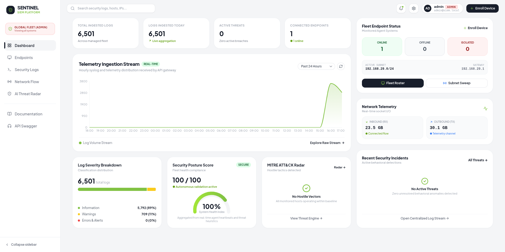
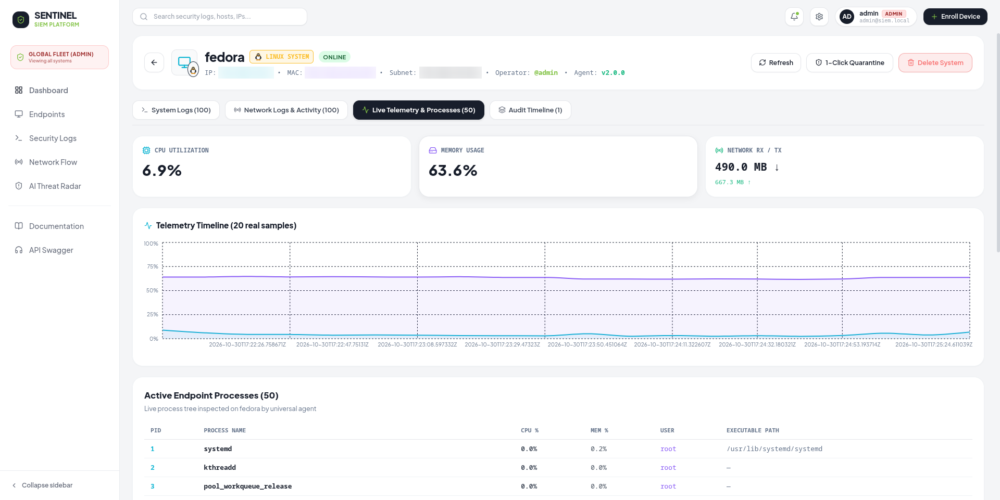

# SENTINEL: Autonomous SIEM & Security Telemetry Platform



**Sentinel** is an autonomous, high-throughput Security Information and Event Management (SIEM) and telemetry platform engineered for modern Security Operations Centers (SOCs). Featuring a compiled Golang core delivering **27µs sub-millisecond event execution**, real-time MITRE ATT&CK correlation, and surgical zero-trust host quarantine.

---

## ⚡ Core Architecture

- **Backend Engine (Golang):** High-throughput log parser (~12,480+ EPS sustained), in-memory lock-free state engine, token authentication, and MITRE ATT&CK AI heuristic radar.
- **Frontend SOC Dashboard (React + Vite + TypeScript):** Real-time command center featuring live telemetry streams, interactive node-and-edge network topology, centralized streaming log humanizer, and endpoint fleet controls.
- **Endpoint Security Agents (Go & Universal Python):** Autonomous cross-platform endpoint agents with native surgical kernel quarantine (`iptables` / WFP / `pf`).
- **Containerization & Cloud CI/CD:** Multi-stage production Docker containers and 1-click cloud manifests for Vercel, Render, and Docker Compose.

---

## 🖥️ Live Endpoint Forensics & Deep Telemetry



*Real-time endpoint deep-dive displaying live CPU/memory load, bidirectional socket I/O, telemetry sample timelines, 1-click zero-trust host quarantine, and active system process inspection.*

---

## 📁 Repository Structure

```text
SIEM-Dashboard-security-information-event-mangement-/
│
├── backend/            # High-performance Golang backend server & native agent
│   ├── cmd/server/     # Go SIEM HTTP & WebSocket server entrypoint
│   ├── cmd/agent/      # Native Go endpoint security agent with kernel quarantine
│   ├── internal/api/   # REST endpoints (auth, logs, devices, threats, network)
│   ├── internal/quarantine/ # Surgical kernel firewall isolation (iptables/WFP/pf)
│   └── tests/          # Integration & unit test suites
│
├── frontend/           # React 18 + Vite + Tailwind SOC command console
│   ├── src/pages/      # Dashboard, Endpoints, Threat Radar, Logs, Network Flow
│   └── vercel.json     # Client-side SPA routing rewrites
│
├── brag-output/        # 30s comprehensive video showcase and social launch pack
├── docs/               # Architecture specs, project reports, and deployment guides
├── docker-compose.yml  # All-in-one containerized production stack
└── render.yaml         # Cloud infrastructure as code manifest for Render
```

---

## 🚀 Quick Start (Local Development)

### 1. Start the Go SIEM Server
```bash
cd backend
go build -o bin/siem-server ./cmd/server
./bin/siem-server
```
*Backend runs on `http://localhost:8000` (Health check: `/health`)*.

### 2. Start the Frontend Dashboard
```bash
cd frontend
npm install
npm run dev
```
*Frontend runs on `http://localhost:5173`*.

### 3. Log In to SOC Command Console
* **Default URL:** `http://localhost:5173`
* **Authentication:** Set your administrator password via the `ADMIN_PASSWORD` environment variable (or let the server generate a random secure token on first boot). Operators can also register accounts directly from the login page.

---

## 🌐 Production Cloud Deployment

The platform is pre-configured for instant zero-cost cloud deployment:
* **Frontend:** Deploy to [Vercel](https://vercel.com) (pre-configured via `frontend/vercel.json`).
* **Backend:** Deploy to [Render](https://render.com) (pre-configured via `render.yaml` & `backend/Dockerfile`).
* **Self-Hosted VPS:** Deploy to any Linux server with `docker compose up -d --build`.

👉 **[Read the Complete Cloud Deployment Guide](docs/DEPLOYMENT_GUIDE.md)** for detailed setup instructions.
