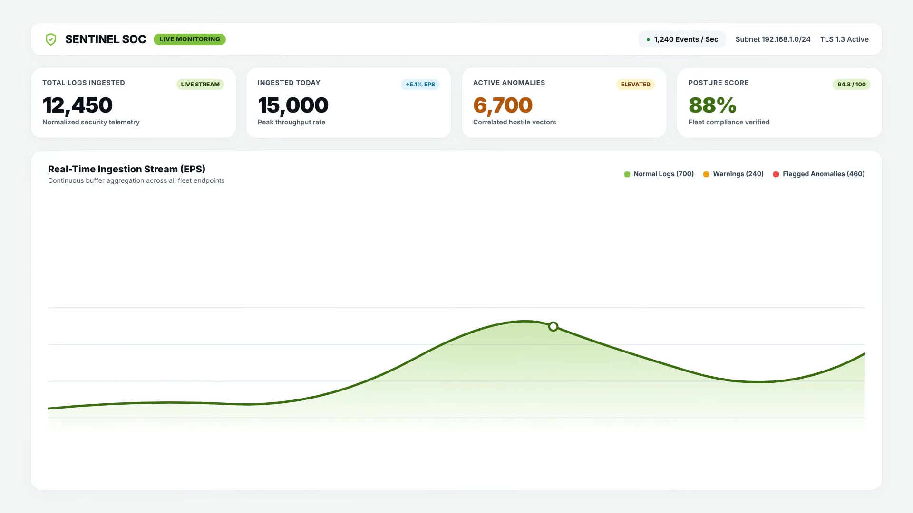

# SIEM MVP - Centralized Device & Log Management



This project is a minimum viable product (MVP) for a centralized security telemetry and log-management platform. It discovers and manages authorized devices, collects system telemetry and logs, normalizes data into a common schema, and provides a centralized React dashboard.

## Architecture

The project consists of:
- **Backend**: FastAPI API server.
- **Frontend**: React (Vite + TypeScript) Dashboard.
- **Database**: MongoDB.
- **Agents**: Python-based endpoint agents for Windows and Linux.

See `docs/architecture.md` for full details.

## Project Structure

```text
siem-mvp/
│
├── backend/            # FastAPI application
├── agents/             # Python agents (Windows & Linux)
├── frontend/           # React dashboard
├── network/            # Network controller abstraction
├── docs/               # Documentation
└── docker-compose.yml  # Docker environment setup
```

## 🌐 Cloud Deployment (Vercel + Render + MongoDB Atlas)

The project is fully pre-configured for free cloud deployment:
- **Frontend:** 1-click deploy to [Vercel](https://vercel.com) (configured via `frontend/vercel.json`)
- **Backend:** 1-click deploy to [Render](https://render.com) (configured via `render.yaml` and `backend/Procfile`)
- **Database:** Free [MongoDB Atlas](https://www.mongodb.com/cloud/atlas) M0 cluster
- **Docker:** All-in-one container stack via `docker-compose.yml`

👉 **[Read the Complete Cloud Deployment Guide](docs/DEPLOYMENT_GUIDE.md)** for step-by-step setup instructions.

## Quick Start (Local)

*To be updated during implementation*

1. Copy `.env.example` to `.env` and configure variables.
2. Run `docker-compose up -d` to start MongoDB.
3. Start the Backend API.
4. Start the Frontend Dashboard.
5. Log in, generate an enrollment token, and start an agent.

## Milestones

See `docs/milestones.md` for the development roadmap.
